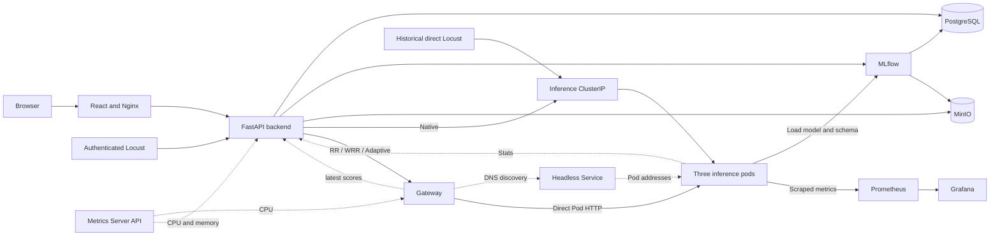

# Nexus MLOps — project context and implementation audit

## 1. Executive Summary

Audit date: 26 November 2026. Checkout: D:\Clone\MLOps-Neel, branch frontend at 59ff9e6, including pre-existing working-tree changes. Nexus MLOps combines a supervised ML lifecycle demo with a Kubernetes inference-routing evaluation. Four routing modes exist. Six historical direct Native runs provide baseline evidence. Matched four-policy results, resource time series and gateway overhead measurements remain outstanding. Source and manifest claims refer to this checkout. A read-only cluster check on 27 November 2026 verified readiness and monitoring. Current test pass rates remain unverified.

## 2. Project Title and Overview

The README calls the project **Nexus MLOps**. The original context describes a **Cloud-Native MLOps Platform for Automated Machine Learning Lifecycle Management**. It brings CSV upload, training, experiment tracking, registration, deployment records, prediction and inference monitoring into one UI. The deployed inference pool serves a single configured MLflow run.

## 3. Problem Statement and Motivation

The project illustrates the work required to move a tabular model from uploaded data to an observable inference service. Its routing study asks how connection-level Kubernetes service routing compares with per-request policies that can consider replica load or observed performance. Connection reuse can skew distribution even across identically configured replicas.

## 4. Project Objectives

Demonstrate a reproducible CPU-based ML workflow on open-source infrastructure. Compare four policies on tail latency, successful throughput, errors, resource use, distribution and adaptive overhead. Deliver a repeatable academic demonstration and evidence for Tables 5.3–5.6 and Figures 5.1–5.4. Multi-tenancy, distributed training and production autoscaling are outside the current implementation.

## 5. Proposed Solution and Contribution

The engineering contribution is the integration of a model lifecycle with a switchable request gateway, dynamic Pod discovery and a telemetry-informed selector. Native mode bypasses the gateway. The custom modes select ready Pod IPs. Improved throughput, latency or distribution remain hypotheses for evaluation. The repository does not establish algorithmic novelty.

## 6. Technology Stack

| Technology | Purpose and version evidence |
|---|---|
| Python 3.11 slim, FastAPI, Uvicorn, Pydantic | Backend, gateway and inference HTTP APIs. |
| PostgreSQL 15, SQLAlchemy, psycopg/psycopg2 | App and MLflow metadata. |
| python-jose, Passlib, bcrypt 3.2.0 | JWT bearer login and password hashing. |
| pandas, scikit-learn, XGBoost, MLflow 2.10.2 | CSV preprocessing, supervised training, experiment artifact logging and PyFunc serving. |
| boto3 and MinIO | S3-compatible dataset and artifact storage. MinIO uses a floating image tag. |
| React 19, TypeScript 6, Vite 8, Tailwind 4 | UI. Axios calls APIs, React Router handles navigation, Recharts charts telemetry, Lucide supplies icons and react-hot-toast shows feedback. Versions are declared ranges. |
| Node 20 Alpine, Nginx, Docker, Compose | Frontend build/proxy, images and local dependencies. |
| Kubernetes, Minikube, kubectl and PowerShell | Local orchestration and manual deployment. |
| Prometheus 2.45.0, Grafana 10.0.0, Metrics Server | Application scraping, dashboards and resource samples. |
| pytest, FastAPI TestClient/HTTPX, Locust | Routing tests and load generation. Backend pins Locust to >=2.32,<3. |

Root requirements split lightweight and ML dependencies. Services have their own requirements and Dockerfiles. Most Python packages are unpinned. Frontend dependencies are locked in frontend/package-lock.json.

## 7. Repository Structure

| Path | Responsibility |
|---|---|
| frontend/ | UI pages, HTTP clients, state, visualization, Nginx proxy and Vite config. |
| backend/ | API, SQL models, training, routing config, telemetry and dashboard Locust. |
| gateway/ | Discovery, selection, forwarding, runtime weights and tests. |
| inference/ | MLflow inference process and replica stats/metrics. |
| kubernetes/ | Namespace, config, RBAC, workloads, PVCs, ingress/headless Service and monitoring. |
| mlflow/, compose.yml | Tracking image and local supporting services. |
| benchmarks/ | Locust workload, two runners and archived CSV/JSON. |
| README.md, Walkthrough.md | Setup and demonstration runbooks. AUDIT.md and local IMPLEMENTATION_REPORT.md have no substantive content. |

Root categorical.csv, mixed.csv, numeric.csv and test_housing.csv are local input data. Generated environments, assets and caches are outside the result corpus, except pytest bookkeeping used as limited execution evidence.

## 8. Complete System Architecture



## 9. End-to-End Request Flow

1. Browser or current Locust sends bearer-authenticated POST /api/v1/predict/{deployment_name} with a JSON features object.
2. backend/main.py:483 resolves the deployment, checks ownership, resolves model/experiment and rejects a run mismatching INFERENCE_RUN_ID. Local edits add explicit nonempty feature-map validation. RoutingConfig selects Native Service or gateway /predict. Backend forwards JSON and run/strategy headers with a 15 s timeout.
3. Native uses the Service dataplane. Custom modes enter gateway/main.py:66, which checks mode and run and selects a discovered Pod IP. HTTPX forwards the payload.
4. Inference returns prediction, replica_id, request_id and latency_ms. Gateway adds gateway_meta with strategy, target, selected replica, model run and elapsed timings. Backend adds deployment. Its native gateway_meta is null.
5. Missing records give 404, ownership denial 403 and run mismatch 400. Upstream HTTP errors are relayed. Transport failures can return 502, no endpoints 503, and gateway upstream timeout 504.

## 10. Machine Learning and Inference Service

backend/ml_utils.py:83,100 infers task type, drops missing rows, one-hot encodes, and uses an 80/20 split with seed 42. Families are logistic/linear regression, random forest and XGBoost with task-specific variants. MLflow records classification metrics (accuracy, precision, recall, F1 and ROC AUC when applicable) or regression metrics (R², MAE, MSE, RMSE). It logs the model and explicit_schema.json. The workload uses Titanic-style features. The exact estimator and training provenance of the deployed run require inspecting its MLflow artifacts.

inference/main.py:53 loads runs:/<MODEL_RUN_ID>/explicit_schema.json and runs:/<MODEL_RUN_ID>/model at startup. An unready prediction can retry loading. There is no synthetic warm-up call. POST /predict accepts either a flat feature map or a features object, validates requirements/categories, converts numeric values, uses pandas dummy encoding and aligns columns with zero fill. MLflow PyFunc predicts; the first output becomes a string and may be mapped to a class label. Pod identity comes from HOSTNAME. GET / identifies the process, /health checks liveness, /ready reports artifact readiness and run, /stats exposes JSON, and /metrics exposes Prometheus text. One Uvicorn process per container keeps counters, 1,000 recent latency values and 30 recent events. Prediction and preprocessing run synchronously inside an async handler. No GPU or batching is configured.

## 11. Kubernetes Implementation

Namespace mlops contains single-replica PostgreSQL and MinIO StatefulSets with 2 Gi and 5 Gi PVCs, and single-replica MLflow, backend and frontend Deployments. Service ports are PostgreSQL 5432, MinIO 9000/9001, MLflow 5000, backend 8000 and frontend 80. Inference has three replicas of mlops-inference:latest on port 8000, requests 100m/256 MiB and limits 500m/512 MiB. Gateway has one mlops-gateway:latest replica on 8080, requests 50m/64 MiB and limits 200m/128 MiB. Both use /ready every 5 s and /health every 10 s. Init containers wait on dependencies. Inference has ClusterIP and headless Services. ConfigMaps provide URLs and routing settings, Secret references supply credentials, and monitoring/gateway RBAC grants relevant pod and metrics access. No HPA or model-specific Kubernetes rollout is defined.

Minikube with Docker is the documented environment. Locally built images are loaded with imagePullPolicy Never. Frontend port-forward is the usual entry point. Ingress is also defined. Other Kubernetes clusters would need available images/storage, compatible DNS/configuration, relevant RBAC and Metrics Server. On 27 November 2026, the active context was minikube. All seven Deployments and both StatefulSets were ready, all 11 pods were Running and Ready, and both PVCs were Bound. The inference Service EndpointSlice listed three endpoints. Each inference pod reported ready with the same MLflow run, b0ca6d39e884422fa6fdb3471a2c1349, and the gateway reported that run, three available replicas and WRR weights 5,3,2. Prometheus reported up=1 for all three inference scrape targets. Grafana 10.0.0 reported database health OK. Metrics Server returned a point-in-time snapshot. All three inference pods were at 3m CPU with 191, 256 and 235 MiB respectively, in pod suffix order 7r8qz, cgfdj and vm99c. The gateway was at 7m CPU and 49 MiB. These snapshots were taken without generating test traffic and are not benchmark results.

## 12. Routing Strategies

backend/routing.py:20,181 defines Native, round_robin, weighted_round_robin and adaptive. GET/PUT /api/v1/inference-monitoring/routing-strategy requires JWT and controls shared in-process state. Weight changes are forwarded to the gateway. Gateway direct calls default to RR. Its APIs include /health, /ready, /replicas, /adaptive-scores, GET/PUT /weights and PUT /adaptive-weights.

| Mode | Selection |
|---|---|
| Native | Backend forwards to inference ClusterIP and Kubernetes selects an endpoint per connection. No gateway policy or per-pod retry. |
| RR | Rotate across sorted ready pod IPs. Stable membership yields deterministic cycling, independent of load. |
| WRR | Smooth weighted rotation. Default positive weights 5,3,2 map to sorted Pod IPs. Extra Pods get 1. Three stable endpoints ideally receive 50/30/20 without retries. Churn can reassign weight. |
| Adaptive | Choose minimum rolling penalty from gateway load, performance and cached CPU. |

gateway/router.py:76–172 resolves headless IPv4 DNS and by default probes /ready with a 1.5 s timeout. Discovery targets 10 s. Membership changes reset WRR accumulators. gateway/main.py:100–143 retries once on connect errors when a different endpoint is selected. Timeout, other transport errors and upstream HTTP responses return immediately. Empty selection returns 503. There is no native fallback or circuit breaker.

```text
RR: take rotating index and advance modulo N; scan up to N turns for a nonexcluded endpoint.
WRR: for up to N turns, add each weight to its accumulator, select first
     maximum, subtract the total weight from the winner, and return it if eligible.
     Excluded winners still update accumulator state.
```

## 13. Adaptive Dynamic Routing Algorithm

gateway/router.py:175–428 uses mean gateway-to-pod HTTP duration in ms, current in-flight gateway attempts, Metrics Server CPU percentage and error fraction. Latency and error windows hold up to 50 attempts. Non-2xx and absent statuses count as errors. RR and WRR also contribute attempt observations. Native does not. CPU sums container millicores, divides by 500m, and caps at 100%. Memory and Prometheus are not inputs to selection.

For every available value x of metric m at replica i, compute EMA E(i,m) = alpha*x + (1-alpha)*old_E, with alpha 0.3 and initial E=x. Apply min-max normalization across available smoothed values, clipping to [0,1]. Equal observed values map to 0. Missing per-pod values map to 1 when the metric is present somewhere. Omit metrics absent everywhere. The penalty is sum(w_m * normalized(i,m)) divided by sum(w_m over usable metrics). Default weights for latency, active, CPU and error are 0.40, 0.30, 0.20 and 0.10.

```text
Background: every ~5 s fetch Pod inventory and Metrics Server usage,
join by Pod name/IP and replace the ready-endpoint CPU cache.
Select under lock:
    Read raw observations and omit expired samples.
    Smooth available observations, normalize and compute penalty for each pod.
    Exclude attempted endpoints from selection, keeping them in normalization.
    Select minimum; for ties within 1e-9, take first at/after rotating cursor,
    wrapping to the first tie if necessary.
    Advance cursor and increment target active count.
HTTP outside lock: record attempt duration/status and decrement active.
```

CPU freshness uses source timestamps. Latency and error freshness use the last recorded attempt for the whole window. Default maximum age is 120 s. API failure can clear CPU. A daemon runs synchronous discovery and metrics HTTP calls off the prediction path. Scoring repeats EMA updates on each invocation and can reuse the same input. Cached EMA can survive temporary missingness. Active counts are always available. Equal penalties rotate as a natural fallback. State updates are lock-protected per process. Per-decision scoring costs O(N × (W+M)) for N pods, window W=50 and M=4; network time is outside the lock. WRR selection is O(N) normally and O(N²) with excluded winners. There are no timing measurements for selection or cache reads.

backend/inference_telemetry.py:423 separately computes a preview from inference stats and max normalization, with missing CPU represented as zero. gateway /adaptive-scores exposes actual last decision, selected endpoint and epoch timestamp. These scores can differ.

## 14. Monitoring and Telemetry

| Signal | Source, units and retention |
|---|---|
| Requests and errors | Inference /stats and inference_requests_total counters, cumulative since process start. Prometheus labels all errors 500, including handled validation errors. |
| Active and ready | Per-pod inference gauges. Gateway active counts separately cover gateway attempts. |
| Latency | Inference lifetime average and recent P50/95/99 in ms, Prometheus summary in seconds with lifetime sum/count. Replica percentiles cannot be averaged into a fleet percentile. |
| Recent requests | In-memory request ID, UTC time of day, replica, latency and status. Artifact loading and failures also log to process output. |
| CPU and memory | Metrics Server snapshots. Backend reports millicores and CPU percentage of 500m, MiB and memory percentage of 512 MiB. Gateway caches CPU only. |
| Traffic share, throughput and errors | Backend derives replica shares, rates in requests/s from changing counters, and error percentage. Bounded histories for latency, distribution and throughput and an event ring feed the dashboard. |
| Routing | Latest gateway adaptive scores, selection and timestamp. Success metadata includes gateway elapsed time including upstream service. |
| Historical metrics | Prometheus scrapes inference pods every 3 s. Grafana has a provisioned datasource and dashboard, ports 9090 and 3000 respectively. Prometheus storage is ephemeral. Current config does not supply CPU history or gateway overhead. |

Exports exist via Prometheus queries and Locust CSV/JSON. Snapshot data and cumulative counters require explicit time boundaries. Counters reset on restart. Dashboard history is process-local.

## 15. Testing and Benchmarking Infrastructure

gateway/test_gateway.py covers discovery, policy selection, proxy, contracts and backend/telemetry paths using mocks. backend/test_routing.py covers mode configuration, auth and weights. Local pytest cache lists 66 node IDs and seven historical failure keys, including names different from current source. This establishes prior pytest activity with no current pass count. A live cluster, frontend, or lifecycle end-to-end suite was not established.

benchmarks/locustfile.py draws valid Titanic-style payloads, requires deployment name and token, sends authenticated backend predictions and waits 100–400 ms per user. It validates prediction content and reports per-replica successes and server timings. The host runner launches profiles of 1 user at 1 spawn/s for 10 s, 3 at 1/s for 30 s and 5 at 2/s for 30 s. It exports Locust CSVs and JSON with before/after kubectl top and Prometheus success-count deltas. It allows one second for the scrape and has no dedicated warm-up. The in-cluster runner expects an existing locust-runner pod with /tmp/locustfile.py staged, targets Service DNS, and copies CSVs from the pod. The current authenticated workload cannot be substituted unchanged for that direct endpoint.

backend/locustfile.py and backend/main.py:655–829 power the dashboard. Defaults are 5 users, 1 target RPS, 10 s and 50 requests. Limits are 50 users, 50 target RPS, 300 s and 10,000 requests. Pacing targets are separate from achieved throughput. Metrics and lifecycle are managed by the backend subprocess and local state, with a live event timeline and dashboard charts. No standalone comparison plotting or experiment orchestration pipeline was found.

## 16. Existing Experimental Results

Six runs on 14 October 2026 UTC. Each profile has Locust stats, history, failure and exception CSVs plus a JSON summary. Host files are the documented port-forward baseline. In-cluster metadata explicitly specifies an ephemeral Locust pod and inference Service DNS. The two smoke CSVs identify POST /predict, the direct inference route. All six summaries report zero failures.

| Path/profile | Users / duration s | Requests | P50/P95/P99 ms | Reported RPS | Success-counter replica share % |
|---|---:|---:|---:|---:|---|
| Host smoke | 1 / 10 | 33 | 17 / 22 / 36 | 3.75 | 100 / 0 / 0 |
| Host light | 3 / 30 | 322 | 14 / 23 / 28 | 11.02 | 100 / 0 / 0 |
| Host moderate | 5 / 30 | 535 | 14 / 24 / 33 | 18.33 | 100 / 0 / 0 |
| Cluster smoke | 1 / 10 | 31 | 17 / 23 / 330 | 3.48 | 0 / 100 / 0 |
| Cluster light | 3 / 30 | 314 | 12 / 18 / 19 | 10.82 | 34.5 / 33.5 / 31.9 |
| Cluster moderate | 5 / 30 | 550 | 12 / 18 / 22 | 19.01 | 60.8 / 39.2 / 0 |

Files: benchmarks/results/baseline_summary.json (16:44:59–16:46:10 UTC), benchmarks/results/cluster_service_dns/cluster_service_dns_summary.json (16:58:17–16:59:28 UTC), and colocated CSVs. Pod suffixes in share order are 7r8qz, cgfdj and vm99c. Cluster moderate records 561 success-counter increments against 550 Locust requests. Scrape boundaries and other traffic can affect differences. CPU and memory are before/after snapshots. In host moderate the active pod changes from 13m to 129m at 231 MiB memory. These samples cannot establish run means. Host hardware, exact runner version, model metadata and other reproducibility settings are absent. The records are preliminary Native evidence. No systematic four-policy results, gateway timings or academic comparison plots were found.

## 17. Experimental Measurement Capability Matrix

| Requirement | Current capability and historical evidence | Remaining work |
|---|---|---|
| Table 5.3 P50/P95/P99 | Locust CSV, measured for six direct Native profiles | Matched authenticated backend runs for all four policies. |
| Table 5.3 successful RPS/error % | Locust totals and rates. Historical zero failures make reported aggregate RPS successful RPS for those runs | Measure successful counts over a common steady window and export errors. |
| Table 5.4 inference CPU % and memory MB | Metrics Server snapshots, backend limit-relative CPU and MiB. Historical before/after only | Sample through runs, compute means and state CPU denominator and memory unit conversion. |
| Table 5.4 gateway CPU % | Metrics Server could sample gateway. Benchmark runner selects inference pods | Add gateway sampling and define idle Native bypass reporting. |
| Table 5.5 percentages for replicas 1–3 | Response IDs and Prometheus deltas. Native historical values only | Export successful response IDs for every run, with stable pod mapping and scrape reconciliation. |
| Table 5.6 average gateway processing | gateway_meta gives elapsed forwarding interval including upstream | Instrument processing separately. Subtracting model time leaves transport and other overhead. |
| Table 5.6 retrieval/cache and scoring ms | Code boundaries only | Instrument background API fetch, hot-path cache access and score computation separately. |
| Table 5.6 additional CPU % | Requires per-run gateway resource samples and baseline | Measure with matched loads and declared denominator. |
| Table 5.6 telemetry interval ms | 5,000 ms CPU refresh target is configured | Export successful fetch and source timestamps to measure cadence and age. |
| Figures 5.1 and 5.2 P95 and throughput | Locust CSV supports both. Baseline data only | Plot matched four-policy results. |
| Figure 5.3 three-replica CPU series | Poll Metrics Server or add resource scraper | Capture time-aligned series in declared units. |
| Figure 5.4 distribution | Response IDs and success counts support charts | Collect all strategies with same definition and intervals. |

## 18. Git History and Development Timeline

| Date in 2026 | Milestone |
|---|---|
| 21 Aug | 8d66c3d initial commit. |
| 7–8 Oct | 9bbd95e schema/MVP stabilization, 35a18cc frontend integration, 4f04a7e MVP and Kubernetes. |
| 11 Oct | a4622c4 task-specific metrics and training changes. |
| 14 Oct | f73cccc Native baseline and lifecycle deletion, f189fe8 monitoring, 20c7c83 and 029c528 telemetry corrections, 99ad5f3 Locust. |
| 15 Oct | 7953830 RR, bbf7228 WRR, 468ed31 Adaptive. |
| 20 Oct | 218e873 dashboard load, 13d260f telemetry stability/runbook, fc1dc09 dashboard polish. |
| 24 Nov | 59ff9e6 adaptive telemetry enhancement. |

Local main points to fc1dc09, cached origin/main to 1bcc858, and local and remote neel-contribution to 59ff9e6. Cached Rutwik/Yadnik refs contain parallel frontend and documentation work. Branches and references were inspected without fetching or switching. Before the audit there were 49 modified tracked files and three untracked frontend files. Changes span backend/main.py and frontend UI, API/auth, styles, routing visualization and Vite. Backend changes include token refresh, health, optional pagination and feature validation. Untracked additions are ConfirmDialog.tsx, Skeleton.tsx and utils/error.ts. Deployment of any local changes remains unverified. The former context's proposed individual service directories and automation tooling were design goals.

## 19. Current Implementation Status

| Feature | Classification | Evidence and remaining work |
|---|---|---|
| Native direct inference | IMPLEMENTED AND VERIFIED | Historical /predict artifacts verify that path on 14 October. Verify through current backend too. |
| Auth, upload, training, tracking and registration | IMPLEMENTED BUT NOT VERIFIED | backend/main.py and ml_utils.py plus UI. Reproduce a clean workflow. |
| RR, WRR and Adaptive | IMPLEMENTED BUT NOT VERIFIED | gateway/router.py, gateway/main.py, mocked tests. Confirm live policy switching, distribution and failures. |
| Per-model deployment | PARTIALLY IMPLEMENTED | Backend metadata and loaded model cache exist. Inference requires a shared pinned run. |
| Monitoring | PARTIALLY IMPLEMENTED | Inference metrics and historical counters exist. Current inference scraping, Metrics Server and Grafana health verified. Add resource history and gateway profiling. |
| Benchmark tooling | PARTIALLY IMPLEMENTED | Locust and historical baselines exist. Add a matched four-policy runner. |
| Data and model version workflow | PARTIALLY IMPLEMENTED | Dataset metadata/storage and app-managed model versions exist. Explicit dataset versioning is missing. |
| RBAC at application role level, drift, automated retraining, rollback, Loki, CI/CD | DOCUMENTED OR PLANNED ONLY | Earlier context includes these goals. Authentication and resource ownership checks exist. |
| Durable routing config, HPA and gateway phase metrics | NOT IMPLEMENTED | No corresponding storage, autoscaler or dedicated timing observed. |
| Exact deployed estimator and current test pass count | UNABLE TO VERIFY | Readiness reports the run ID, and no tests were run in this audit. |

## 20. Completed Work

The repository has the main lifecycle UI and API, dedicated inference and gateway images, Kubernetes manifests, four routing modes, a monitoring stack, two forms of Locust traffic generation and six historical direct Native baselines. Source presence and historical execution are distinguished in section 19.

## 21. Incomplete and Pending Work

Essential work is to validate the aligned inference run and end-to-end demo, collect matched data for all policies and generate academic charts/tables. Add gateway timing boundaries and sustained resource capture. Optional scope includes explicit dataset versioning, automated rollout and rollback, drift/retraining, notifications, CI/CD and HPA.

## 22. Technical Problems and Limitations

**Confirmed in code or artifacts**

- The deploy API creates a record and loads a model in the backend. Serving uses a separate fixed run. Deployments with other runs can be rejected at prediction (backend/main.py:383,505).
- The gateway retains the first readiness run ID it sees and does not check all Pod run IDs for equality (gateway/router.py:76–95). Mixed-run rollouts can undermine its run check.
- Smooth WRR positions are unstable under Pod IP changes. The bounded exclusion loop can spend its turns on a highly weighted excluded replica and return empty although another exists (gateway/router.py:376–416).
- EMA updates on scoring cadence and reuses observations. The preview score uses different data and normalization.
- Strategy/weights and counters live in memory and reset with processes. Gateway creates a fresh HTTPX client per prediction. Prometheus storage is ephemeral.
- Archived direct requests and current authenticated requests have different paths. Archived success deltas disagree with client counts.

**Potential risks**

- Single-node Minikube can co-locate Locust, serving and monitoring. There is no evidence that resource exhaustion or runner saturation caused recorded skew.
- Synchronous model work in the async inference handler can add queueing. Cancellation can bypass gateway attempt recording. Slow readiness and Metrics API calls share a background thread and can delay refreshes.
- Missing-value penalties can disadvantage cold replicas, and repeated observations can make smoothing load-dependent. Validate with controlled pressure and idle-to-load transitions.
- Pinned run availability, floating images and dependency versions affect clean-cluster reproducibility. Check frontend Node/Vite compatibility when validating builds.

## 23. Recommended Next Steps

1. Verify current builds, tests, aligned MLflow artifacts and ready replicas. Confirm Metrics Server, Prometheus targets and dashboard switching.
2. Use the same authenticated backend endpoint, deployment and payload distribution for all modes. Capture code/image/model versions, environment, policy and weights, workload, warm-up and steady interval.
3. Export Locust response data with per-replica success IDs, sample CPU/memory for inference and gateway, and instrument gateway processing, selection, cache and background retrieval.
4. Repeat matched runs, account for connection reuse and counter resets, reconcile client and pod counts, and generate only comparisons supported by the captured evidence.
5. Rehearse login, model workflow, live strategy switches and telemetry before the demonstration.

## 24. Important Source Files and Their Responsibilities

| File and line anchors | Responsibilities |
|---|---|
| backend/main.py:194,249,342,383,483,581,598,714 | Upload, training, registry, deployment, prediction, routing, telemetry and Locust start. |
| backend/models.py:14 and backend/ml_utils.py:100 | SQLAlchemy and request schema, ML training pipeline. |
| backend/routing.py:20,181 | Strategy/weights state and target URL. |
| gateway/router.py:108,150,252,292,376,420 | Discovery, background worker, CPU refresh, scoring, selection and result accounting. |
| gateway/main.py:66,194,217 | Forwarding, live score snapshot and weights. |
| inference/main.py:53,103,125,154 | MLflow load, JSON stats, metrics and inference. |
| backend/inference_telemetry.py:41,423,452 | Dashboard aggregation, preview score and throughput. |
| frontend/src/pages/InferenceMonitoringPage.tsx and frontend/src/components/monitoring/ | Dashboard controls, charts, timing and routing visualization. |
| benchmarks/run_benchmarks.py:137, run_in_cluster_benchmarks.py:129, locustfile.py:161 | Host runner, direct in-cluster runner and current authenticated workload. |

## 25. Uncertainties and Blockers

The initial sandboxed kubeconfig read was denied. The 27 November cluster checks succeeded with user-approved access and required no permission changes. Exact image-to-commit provenance, the saved estimator type and current prediction behavior remain unverified. Existing artifacts lack hardware details, exact commands and enough metadata to reproduce their environment. This audit ran no tests, started no experiments, installed no dependencies and made no deployment changes.

## 26. Complete Project Handoff Summary

### COMPLETE PROJECT CONTEXT FOR ANOTHER AI ASSISTANT

Nexus MLOps is an academic CPU tabular lifecycle demo and inference routing comparison. React/Vite/Nginx routes to Python 3.11/FastAPI. PostgreSQL stores metadata, MinIO stores datasets and MLflow artifacts, and MLflow 2.10.2 tracks sklearn/XGBoost training and schema artifacts. The deployment UI creates application metadata. The Kubernetes serving pool is three identically configured pods pinned to a shared MLflow run. Actual estimator identity is unknown. Startup loads PyFunc and explicit schema. Prediction validates features, one-hot encodes, aligns encoded columns and returns a string prediction, Pod ID, request ID and inference time. Dataset versioning, production rollout/rollback and drift automation remain incomplete or absent.

Backend POST /api/v1/predict/{deployment_name} authenticates and verifies deployment ownership and run consistency. Native goes directly to the inference ClusterIP. RR, smooth WRR and Adaptive go through the gateway on port 8080, which discovers Pod IPs by headless DNS with about 10 s discovery and readiness probing. RR rotates over sorted IPs. WRR uses 5,3,2 by position and defaults extra weights to 1. Adaptive takes mean gateway attempt duration, current gateway in-flight count, cached Metrics Server CPU percentage of 500m and non-2xx/transport error fraction. Windows hold 50 attempts. It smooths available values with alpha 0.3 per scoring call, min-max normalizes across pods, assigns missing values 1 where other pods have data, removes wholly absent metrics and renormalizes weights 0.40/0.30/0.20/0.10. Equal observations contribute zero; ties rotate. CPU refresh is configured at 5 s with 120 s freshness. There is one extra connect-error attempt when an eligible different endpoint can be selected. Native traffic bypasses gateway telemetry. Dashboard preview and actual gateway penalties use different formulas.

The mlops namespace uses Minikube Docker-loaded images and frontend port-forward for the demo. Inference requests 100m/256 MiB per replica with 500m/512 MiB limits. Gateway requests 50m/64 MiB with 200m/128 MiB limits. Prometheus scrapes inference every 3 s and Grafana is provisioned. Metrics Server exposes resource snapshots. App and gateway counters/routing state are in memory. There is no captured resource time series or gateway phase breakdown. See README.md, Walkthrough.md, backend/main.py, backend/routing.py, backend/inference_telemetry.py, gateway/router.py, gateway/main.py, inference/main.py and kubernetes/.

Pytest routing suites and dashboard/CLI Locust exist. Current test pass rate is unknown. The 27 November Minikube check verified three ready replicas serving the same run, gateway readiness, Prometheus scraping, Metrics Server and Grafana health. CLI Locust sends authenticated Titanic-shaped predictions. The only archived experiments are six direct Native profiles on 14 October 2026 under benchmarks/results. They record zero failures and P95 of 18–24 ms, with varied replica share, counter discrepancies and before/after CPU/memory. The host port-forward and in-cluster Service-DNS paths are separate historical conditions. These do not measure the custom policies or a common authenticated path. Current branch frontend at 59ff9e6 has pre-existing backend and frontend edits.

Next, verify a clean lifecycle, identical serving artifacts, metrics and policy switching. Capture matched backend load runs for all modes with warm-up, steady windows, per-response replica IDs, CPU/memory time series and separately instrumented gateway timings. Produce Tables 5.3–5.6 and Figures 5.1–5.4 from the captured evidence. Any performance advantage remains a hypothesis.
